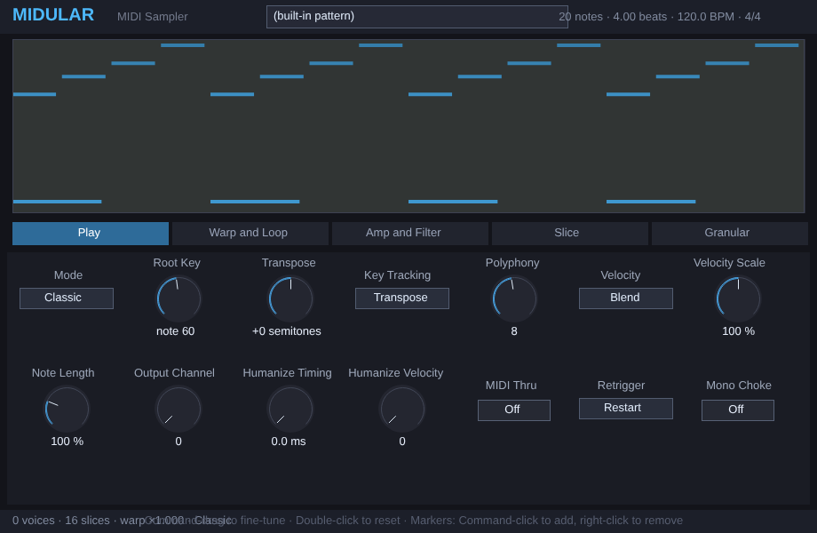

# Midular for Ableton Live

A Max for Live MIDI effect. It is `Midular.jsfx` and its three `.jsfx-inc` files, unchanged, running on Middaw's EEL2 runtime, with its own window: a MIDI phrase mapped across the keyboard and shaped like a sample.

## Installing

Needs **Live 12.1 or later with Max for Live** (Live Suite, or Standard with
the add-on): the device runs on Max 9's JavaScript engine (`[v8ui]`).

1. Copy `Midular.amxd`, `Midular.js` and `Midular.maxpat` into one folder, for
   example `Music/Ableton/User Library/Presets/MIDI Effects/Max MIDI Effect/`. The `.amxd` finds
   `Midular.js` beside it.
2. Drag `Midular.amxd` onto a MIDI track, in front of an instrument.
3. Optional: open it in the Max editor and click **Freeze Device**, then save.
   The device then carries the script inside it and can be moved on its own.

## Using it

| | |
| --- | --- |
| **Load Clip** | Hands the clip open in Detail View to Midular, as `Scripts/midular_import.lua` hands it a REAPER item: its selected notes if any are selected, else its loop. Play a key to hear it. |
| **Show Window** | Opens Midular's own window, the one REAPER shows: the phrase, the modes, warp, envelope and filter. Click, drag and Tab work as they do there. |

Everything Midular saves in REAPER (its @serialize, the phrase included) is saved with the Live set.

## How it is built

`ableton/device.json` describes the device; `python3 ableton/kit/build.py
ableton/device.json` writes the `.amxd`, the `.maxpat` and the script bundle
`Midular.js`. The bundle is Middaw's EEL2 runtime, `Midular.jsfx` and its includes from the repository root, the shared window (`ableton/kit/jsfx_device.js`, `gfx.js`) and `ableton/actions.js`, the importer's part. See `ableton/kit/VENDORED.md`.

`node --test ableton/tests/test_device.js` runs the device on a pretend Max and Live: the window draws and answers clicks all over it, notes go through and end, Load Clip hands a clip over through the importer's mailbox and a key plays it back, and the state is saved and comes back. `node ableton/kit/test/shot.js ableton/Midular.js 920 600 out.png` draws the window.

## Limits

- **It has not been opened in Live yet.** It is tested in Node against a stand-in for Max and the Live Object Model; nothing has run in Max. If the `.amxd` will not open, open `Midular.maxpat` in Max and save it as a device.
- MIDI goes in and out on Max's JavaScript clock, every 4 ms, not on the audio thread: up to a few milliseconds late, which an arc of CC or a held chord does not show but a tight rhythm may.
- Its controls are not Live parameters, so they cannot be automated or mapped; they are saved with the set.
- Slice markers come from REAPER take markers in the importer; a Live clip has none to give, so a loaded phrase arrives without markers. Command-click in the window adds them.
